# OpenFocus

[](https://github.com/graphicmismatch/OpenFocus/actions/workflows/build.yml)

**An open-source Android app blocker, Shorts/Reels blocker, focus timer and habit tracker, all wrapped in a gentle RPG.**

OpenFocus mixes ideas from a few kinds of apps: an app blocker and a pause-before-you-scroll screen, a focus timer, a Habitica-style hero with XP, HP and coins, and an "ascent" view where each long-term goal is a mountain you climb.
Everything stays on your device: there are no accounts, no analytics and no network permission.

| Today | Habits | Focus | Goal ascent | Shield | Hero |
|---|---|---|---|---|---|
|  | 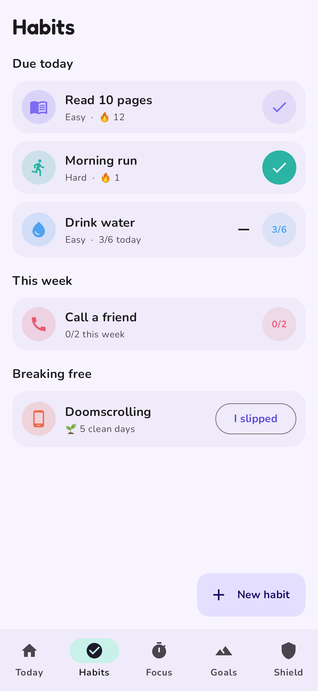 |  | 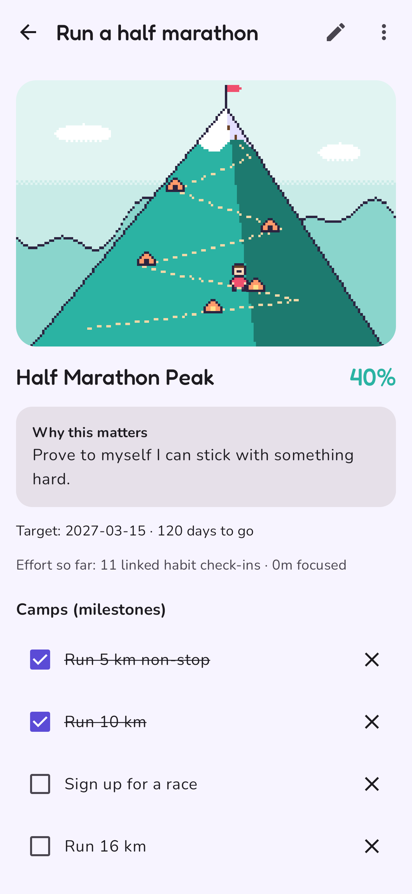 | 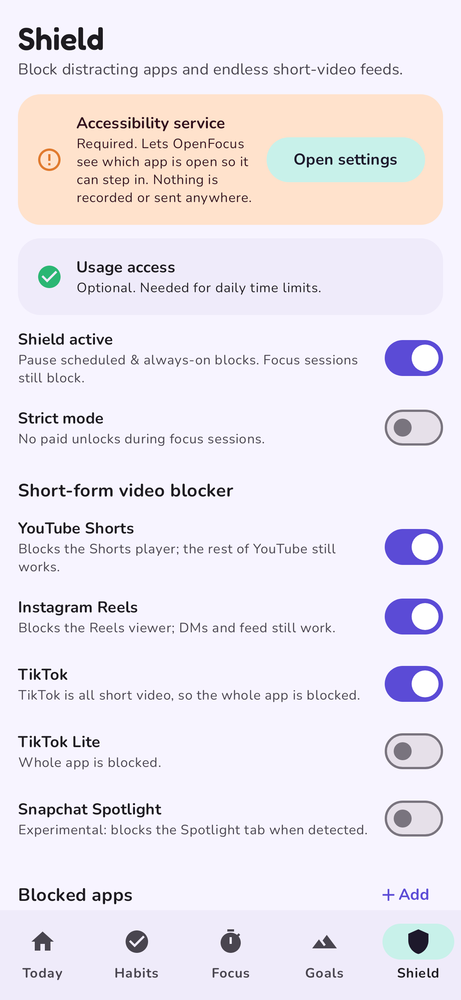 |  |

Dark theme: [`docs/screenshots/dark/`](docs/screenshots/dark)

| Pause (waiting) | How long? | Unlock with coins | Reels blocked | Your own look | Settings |
|---|---|---|---|---|---|
| 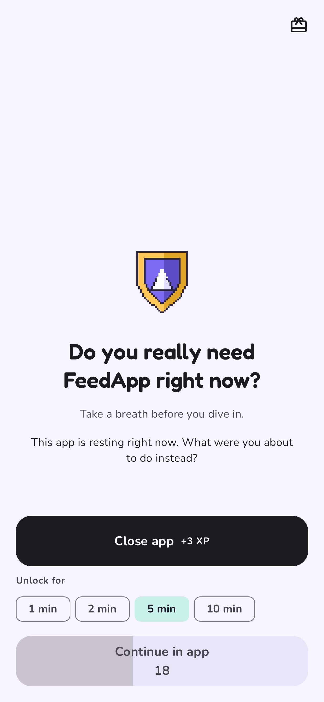 | 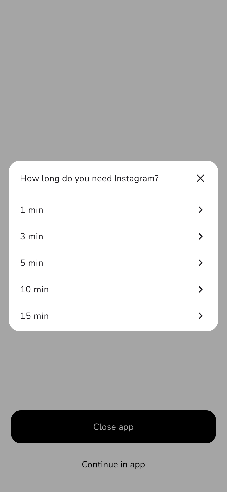 | 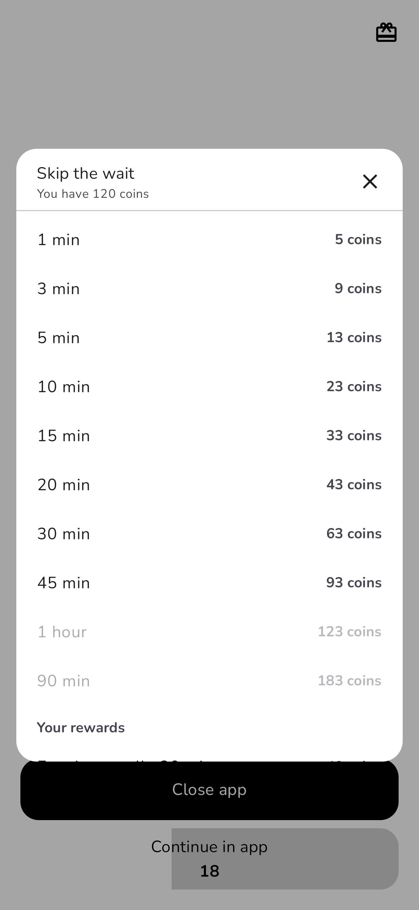 | 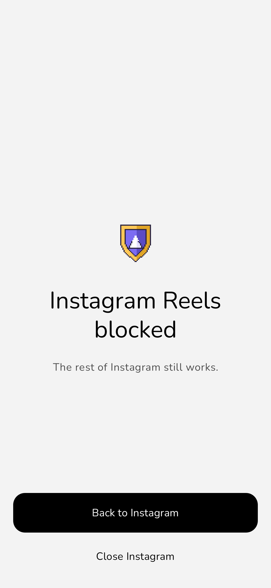 | 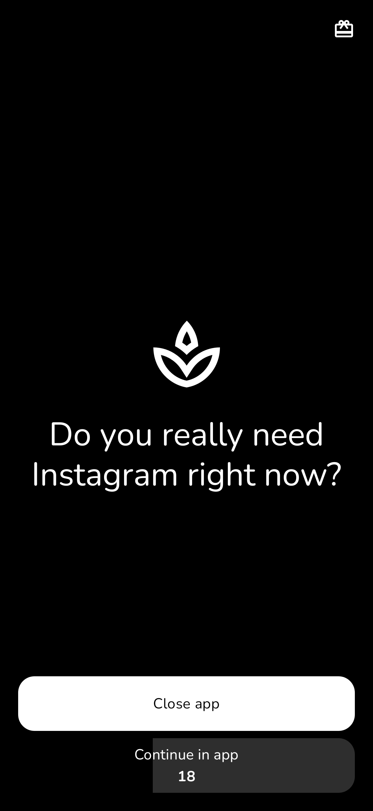 | 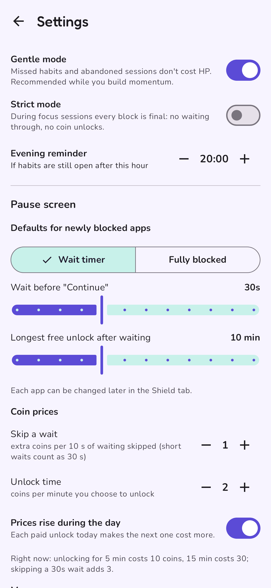 |

| Level up | First day |
|---|---|
| 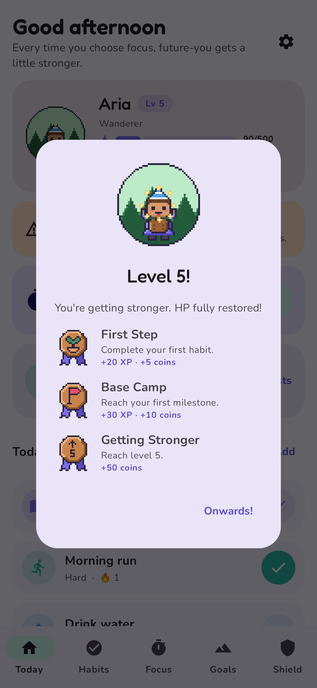 | 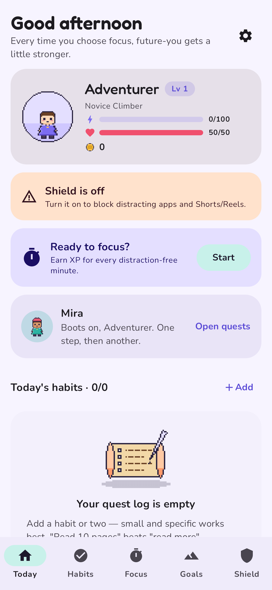 |

## Features

### 🛡️ Shield (app blocker)
- Block apps **always**, after a **daily time limit**, or only **during focus sessions and schedules**.
- **Schedules**, including overnight windows such as 22:00–07:00 on chosen days.
- **Ascent-style pause screen.** Instead of throwing you out, a calm screen covers the app: one question, *Close app* (which earns XP), and, on wait-timer apps, *Continue in app*, which fills up as the timer runs. After tapping Continue, a sheet asks how long you need.
- **You choose, per app, what the pause screen allows** (Shield tab → *Edit*):
  - **Wait timer:** *Continue in app* fills up over any wait from 5 s to 10 min. You then **choose how long to unlock**, up to the app's free maximum (1–120 min).
  - **Fully blocked:** *Close app* is the only option.
  - **Coins on or off:** whether coins may skip the wait or buy a pass for that app.
- **Unlock with coins:** the 🎁 button lets you pick any unlock length up to an hour. Longer unlocks cost more (coins per minute), and skipping a wait adds its own fee.
- **…or with your own rewards:** a self-made reward can optionally unlock a specific app or any blocked app, e.g. *"Evening scroll: 30 min of Instagram for 40 coins"*. Its price is fixed and doesn't rise during the day. It appears on that app's pause screen, and redeeming it from Hero → Rewards unlocks the app straight away.
- **Make it yours** (Settings → *Pause screen*):
  - the gate, wait and open time that newly blocked apps start with
  - coin prices (including free), and whether they rise with each paid unlock that day
  - the pause screen's **look**: icon and colour pair, with a live preview
  - your own question (`{app}` becomes the app's name) and a personal reminder
- **Strict mode** makes every block during a focus session final: no waiting through and no coin unlocks.
- Some apps are never blocked: the launcher, phone/dialer, keyboard, Settings and OpenFocus itself.

### 📵 Short-form video blocker
- **YouTube Shorts** and **Instagram Reels**: only the short-video player is blocked, so the rest of each app keeps working.
- **TikTok / TikTok Lite**: the whole app is blocked.
- **Snapchat Spotlight**: experimental.
- The detection rules are plain data in [`ShortsDetector.kt`](app/src/main/java/org/openfocus/app/blocking/ShortsDetector.kt), so they are easy to update when apps change.

### ⏱️ Focus
- Pomodoro-style sessions from 5 to 180 minutes, with a foreground-service countdown in the notification shade.
- **Deep focus** blocks every app except an allow-list, for 25% more XP.
- You can link a session to a long-term goal. A weekly chart and session history show how you've been doing.
- Ending a session early still gives partial credit, so stopping is never worse than not starting.

### ✅ Habits
- **Build** habits can be daily, on specific weekdays, or *N times per week*, with an optional count per day.
- **Break** habits (e.g. "Doomscrolling") count clean days, and you log slips honestly.
- Streaks, an 18-week heatmap, four difficulty levels, icons and colours. Each habit can be linked to a goal.

### 🎮 Gamification
- **XP and levels**, with titles from *Novice Climber* to *Summit Legend*.
- **Cosmetics** in data-driven slots: cloaks, armour, hats and backdrops.
- **HP**: missed habits cost HP. If HP hits zero, your hero takes a rest and loses a few coins. **Gentle mode** is on by default and turns this off.
- **Coins** buy cosmetics and **rewards you define yourself**. A reward can be a real-life treat or, optionally, time in a blocked app.
- **20 achievements**, a "perfect day" streak, celebration dialogs and a journal of everything you've earned.
- Original encouragement lines throughout.

### ⚔️ Quests and bosses
- **Story quest lines** with several stages, given by NPCs (Mira the trail guide, Oren the hermit) who talk to you in short conversations with pixel portraits.
- **Boss fights, Habitica-style:** while a boss stage is active, every habit you complete deals damage equal to its XP, focus deals 1 damage per minute, and resisting a blocked app, reaching a milestone or finishing a goal hit harder. Missed dailies and slips let the boss **strike back** (not in gentle mode).
- **Collection quests:** habits and focus sessions can turn up quest items.
- **Objective stages** ("focus for 25 minutes", "resist 5 temptations"), quest scrolls bought with coins, repeatable boss hunts, and prerequisites that unlock later chapters. One quest runs at a time; you can leave it whenever you like.

### 🏔️ Long-term goals
- Each goal is a mountain. **Milestones are camps** along a winding trail, and your climber moves up as you reach them.
- Goals can have a "why", a target date and a summit name. The goal also shows the linked habit check-ins and focus minutes that went into it.

### 🌍 Translations
App text lives in `res/values/strings*.xml` and game content has its own translation files, so a new language needs no code. Android 13+ lists every translation in the per-app language picker automatically. See **[docs/TRANSLATING.md](docs/TRANSLATING.md)**.

## Building

Requirements: JDK 17+ and the Android SDK (API 35).

```bash
./gradlew :app:assembleDebug        # APK in app/build/outputs/apk/debug/
./gradlew :app:testDebugUnitTest    # logic tests + Robolectric screenshot tests
```

The screenshot tests write their PNGs to `docs/screenshots/`.

Every pull request and push to `main` runs all tests and a minified release build in GitHub Actions ([`build.yml`](.github/workflows/build.yml)). Each push to `main` that passes is published as a **[GitHub Release](../../releases)** with the APK attached. Signing and versioning are covered in [docs/RELEASING.md](docs/RELEASING.md).

### Game content
All cosmetics (cloaks, armour, hats, backdrops and any new slot), achievements, starter habits, quest lines, NPCs and their dialogue, bosses, level titles and messages are **data**, in [`app/src/main/resources/content/content.json`](app/src/main/resources/content/content.json). To add more, use the local developer-only [content editor](tools/content-editor/README.md):

```bash
python3 tools/content-editor/server.py   # http://127.0.0.1:8765
```

### First run on a device
1. Name your hero and pick a few starter habits.
2. Turn on the **OpenFocus Shield** accessibility service: *Settings → Accessibility → OpenFocus Shield*.
3. Optionally grant **Usage access** (needed for daily limits) and notifications.

> **Note:** On Android 13 and later, apps you sideload may need *Allow restricted settings* (App info → ⋮) before you can turn on the accessibility service. This doesn't apply when you install from an app store such as F-Droid.

## Payment apps and Play Protect
OpenFocus needs Android's **accessibility service** to see which app is open, because that's how blocking works. Banking malware abuses the same API, so Android and payment apps are cautious:
- **Google Pay and many banking/UPI apps** may limit payments while an accessibility service installed **outside Google Play** is on. If that happens, switch *OpenFocus Shield* off (Settings → Accessibility) while you pay. Uninstalling also works.
- **Play Protect** may refuse to install sideloaded apps that request accessibility (especially in regions with *enhanced fraud protection*). **Please don't turn Play Protect off** to get around this. It protects everything else on your phone too.

The proper fix is installing from **Google Play**, which this project is working towards (see [docs/RELEASING.md](docs/RELEASING.md)). Until then, test sideloaded builds on a phone you don't use for payments.

## Privacy
The accessibility service only learns which app is in front. It subscribes to screen-content events **only while one of the video apps you enabled is open**, and then reads only element IDs so it can recognise a short-video feed. Before you turn it on, an in-app disclosure explains this. It never reads text you type, never records the screen, and never sends anything off the device. The app does not request internet permission.

## Credits and licences
- **Code:** GPL-3.0-or-later (see [LICENSE](LICENSE)).
- **Fonts:** [Nunito](https://github.com/googlefonts/nunito) and [Fredoka](https://github.com/hafontia/Fredoka-One), under the SIL Open Font License 1.1 (see [`licenses/`](licenses)).
- **Icons:** [Material Icons](https://fonts.google.com/icons), Apache License 2.0.
- **Art:** pixel-art placeholders and code-drawn scenes, all CC0 (see [`art/CREDITS.md`](art/CREDITS.md)). Real pixel art is very welcome; see the [art guide](art/README.md).

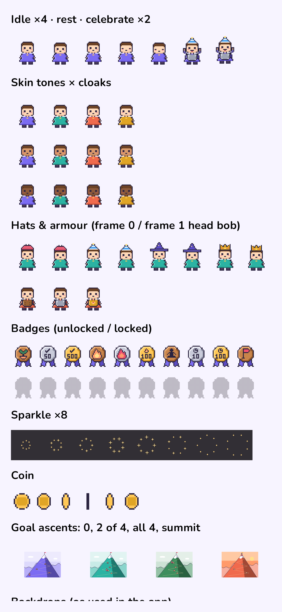

See [ARCHITECTURE.md](ARCHITECTURE.md) for how the code is organised, including how multiplayer features could be added later.
