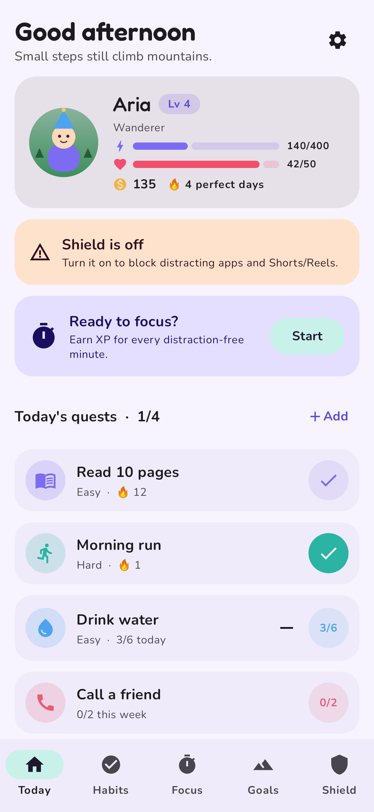
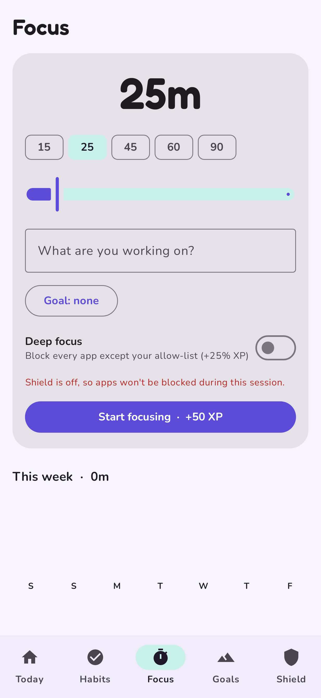
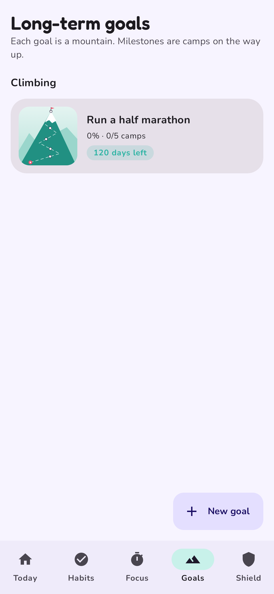
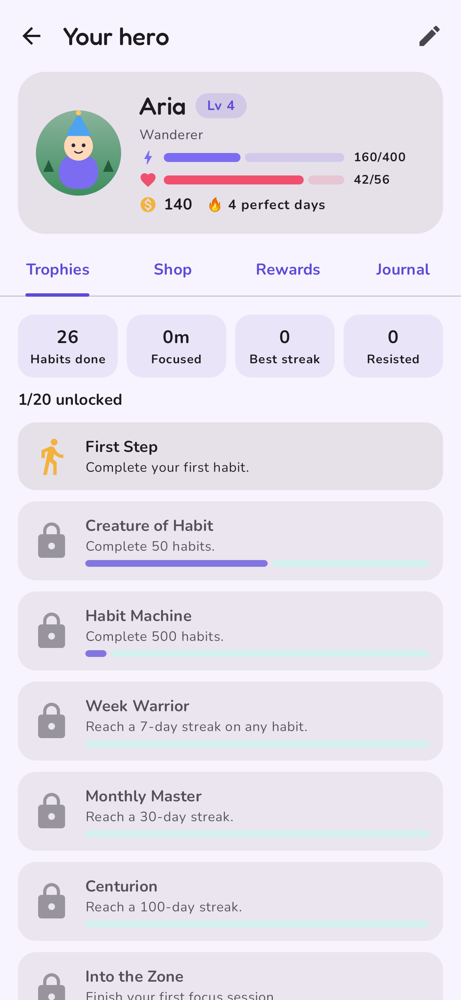

# OpenFocus

**An open-source Android app blocker, Shorts/Reels blocker, focus timer and habit tracker, all wrapped in a gentle RPG.**

OpenFocus mixes ideas from a few kinds of apps: an app blocker and a pause-before-you-scroll screen, a focus timer, a Habitica-style hero with XP, HP and coins, and an "ascent" view where each long-term goal is a mountain you climb.
Everything stays on your device: there are no accounts, no analytics and no network permission.

| Today | Habits | Focus | Goals | Shield | Hero |
|---|---|---|---|---|---|
|  |  |  |  |  |  |

## Features

### 🛡️ Shield (app blocker)
- Block apps **always**, after a **daily time limit**, or only **during focus sessions and schedules**.
- **Schedules**, including overnight windows such as 22:00–07:00 on chosen days.
- **Pause screen** with a 5-second breathing prompt. Choosing *Close app* earns XP. If you really need the app, you can buy a 5 or 15 minute unlock with coins, and each unlock costs more than the last one that day.
- **Strict mode** turns off paid unlocks during focus sessions.
- Some apps are never blocked: the launcher, phone/dialer, keyboard, Settings and OpenFocus itself.

### 📵 Short-form video blocker
- **YouTube Shorts** and **Instagram Reels**: only the short-video player is blocked, so the rest of each app keeps working.
- **TikTok / TikTok Lite**: the whole app is blocked.
- **Snapchat Spotlight**: experimental.
- The detection rules are plain data in [`ShortsDetector.kt`](app/src/main/java/org/openfocus/app/blocking/ShortsDetector.kt), so they are easy to update when apps change.

### ⏱️ Focus
- Pomodoro-style sessions from 5 to 180 minutes, with a foreground-service countdown in the notification shade.
- **Deep focus** blocks every app except an allow-list, for 25% more XP.
- You can link a session to a long-term goal. A weekly chart and session history show how you've been doing.
- Ending a session early still gives partial credit, so stopping is never worse than not starting.

### ✅ Habits
- **Build** habits can be daily, on specific weekdays, or *N times per week*, with an optional count per day.
- **Break** habits (e.g. "Doomscrolling") count clean days, and you log slips honestly.
- Streaks, an 18-week heatmap, four difficulty levels, icons and colours. Each habit can be linked to a goal.

### 🎮 Gamification
- **XP and levels**, with titles from *Novice Climber* to *Summit Legend*.
- **HP**: missed habits cost HP. If HP hits zero, your hero takes a rest and loses a few coins. **Gentle mode** is on by default and turns this off.
- **Coins** buy cosmetics (hats, cloaks, backdrops) and real-life **rewards you define yourself**.
- **20 achievements**, a "perfect day" streak, celebration dialogs and a journal of everything you've earned.
- Original encouragement lines throughout.

### 🏔️ Long-term goals
- Each goal is a mountain. **Milestones are camps** along a winding trail, and your climber moves up as you reach them.
- Goals can have a "why", a target date and a summit name. The goal also shows the linked habit check-ins and focus minutes that went into it.

## Building

Requirements: JDK 17+ and the Android SDK (API 35).

```bash
./gradlew :app:assembleDebug        # APK in app/build/outputs/apk/debug/
./gradlew :app:testDebugUnitTest    # logic tests + Robolectric screenshot tests
```

The screenshot tests write their PNGs to `docs/screenshots/`.

### First run on a device
1. Name your hero and pick a few starter habits.
2. Turn on the **OpenFocus Shield** accessibility service: *Settings → Accessibility → OpenFocus Shield*.
3. Optionally grant **Usage access** (needed for daily limits) and notifications.

> **Note:** On Android 13 and later, apps you sideload may need *Allow restricted settings* (App info → ⋮) before you can turn on the accessibility service. This doesn't apply when you install from an app store such as F-Droid.

## Privacy
The accessibility service only reads the package name of the app in front. Inside the supported video apps, it also reads screen layout IDs so it can recognise a short-video feed. It never reads text you type, never records the screen, and never sends anything off the device. The app does not request internet permission.

## Credits and licences
- **Code:** GPL-3.0-or-later (see [LICENSE](LICENSE)).
- **Fonts:** [Nunito](https://github.com/googlefonts/nunito) and [Fredoka](https://github.com/hafontia/Fredoka-One), under the SIL Open Font License 1.1 (see [`licenses/`](licenses)).
- **Icons:** [Material Icons](https://fonts.google.com/icons), Apache License 2.0.
- **Art:** the hero, mountain and launcher art are **original placeholders** drawn in code, released as CC0. Real art is very welcome; see [CONTRIBUTING.md](CONTRIBUTING.md).

See [ARCHITECTURE.md](ARCHITECTURE.md) for how the code is organised, including how multiplayer features could be added later.
